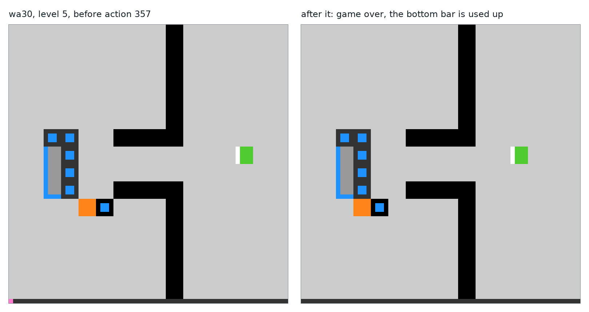
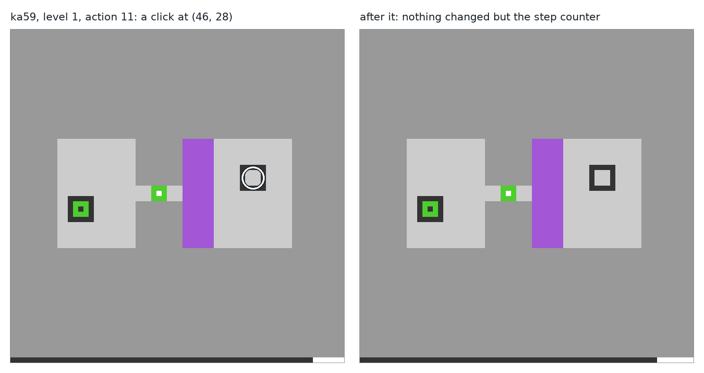
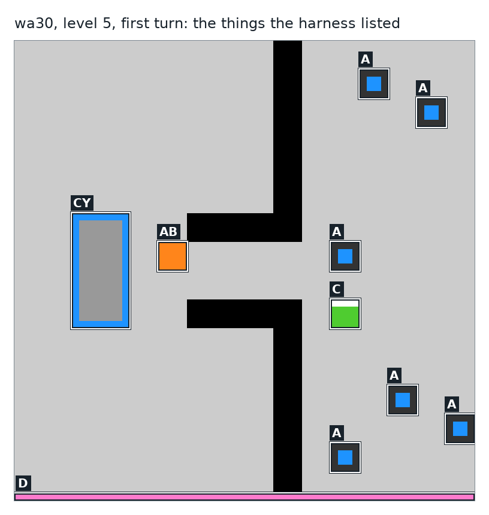
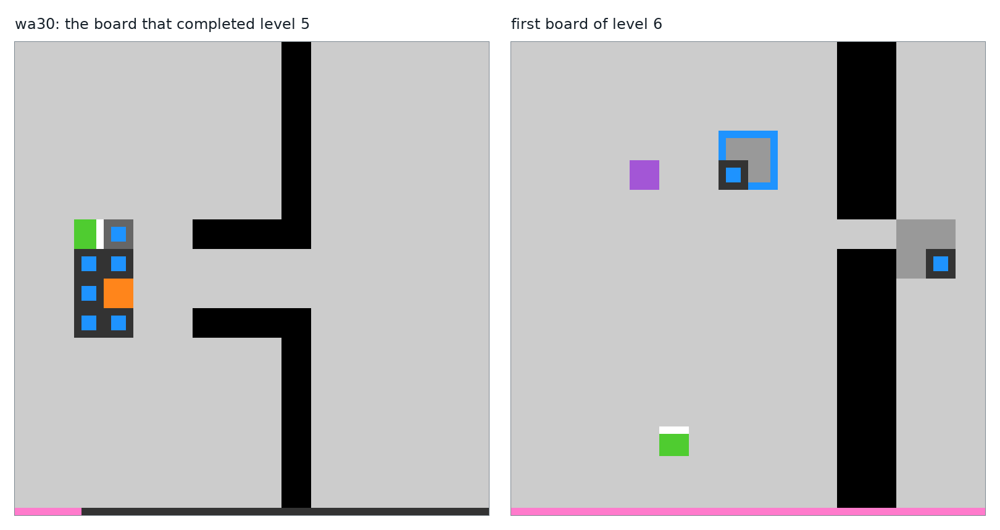

# Figures: one moment per layer

Boards are drawn exactly as the game returned them: 64 by 64 cells in ARC's 16 colours, 12 pixels a cell. All four moments are from the whole-game runs with every layer on, the runs behind the final scorecard (https://arcprize.org/scorecards/96932ddf-ab6a-4354-94b2-9644447dae14). The text quoted below is what the model wrote, word for word; none of it is drawn into the images, so it can go in a caption.

Made by `research/level_brief_v1/paper_figures.py` from the run logs.

## Lesson after a game over

`lessons-game-over.png`, 1620 by 860 pixels.

wa30, level 5. Action 357 (ACTION3) used the last cell of the bar along the bottom row and the game ended; the controller then reset the level. On its next turn (action 359) the model wrote this lesson, which stayed in every later request:

> Rule: The bar on row 63 is an action budget. Its 7 cells turn to 4 about one every two actions, and the game is over when the last 7 is gone, whatever else is happening on the board.
>
> Applies when: Count the 7 cells left on the bottom row and multiply by about 2. If the moves still needed to cover every target tile come to more than that, the attempt will fail. Plan the shortest delivery route from the start and avoid wasted moves.

Source log: `whole-wa30-20261122T173235Z-c1` (local; not in the repository).

## Lesson after an action that changed nothing

`lessons-no-effect.png`, 1620 by 860 pixels.

ka59, level 1. Action 11 clicked the ringed cell and the board came back the same apart from the step counter along the bottom row (1 cell differs), which the harness sets aside. The harness opened a case, and after 1 further action of its own the model explained it (action 13):

> Rule: ACTION6 only does something when it clicks a cell of a 3x3 e-box, which it then selects. Clicking a frame, floor, wall, f region or background changes nothing apart from the step counter. Likewise, a move whose destination cells include 2-background or f is blocked and only uses up a step.
>
> Applies when: The ACTION6 target is not part of an e-coloured 3x3 box, or a move action would put any of the selected box's cells on a 2 or f cell.

Source log: `whole-ka59-20261121T235533Z-c2` (local; not in the repository).

## Object ledger

`object-ledger.png`, 816 by 860 pixels.

wa30, the board before action 233 (the first turn of level 5). The outlines are the places the harness listed, each with the name the ledger gives its look. The model's own notes on what a look does, carried over from earlier levels:

- **AB** (1 place): "An autonomous c block. It moves one tile per player action toward a box, and when it is next to the box it grabs it (the box border turns 4 to 5)."
- **C** (1 place): no note yet
- **D** (1 place): no note yet
- **CY** (1 place): no note yet
- **A** (6 places): "A box. When the player is next to it and facing it, its border turns 3. Action 5 grabs it (border 0). After that, moving toward it pushes it one tile per move. The player can't walk into a box it hasn't grabbed."

What the model wrote about its target on this turn: "I'm aiming at box A at (44,28), the nearest box and right beside the corridor. Boxes like it worked before: grab it, then drag it left into the corridor toward c and the target. c (AB) is untouched on this level and sits at the corridor's left end."

Source log: `whole-wa30-20261122T173235Z-c1` (local; not in the repository).

## Kept rules and the level brief

`level-brief.png`, 1620 by 860 pixels.

wa30. Action 591 completed level 5. Left: the frame the harness kept as completion feedback (the last frame the game returned before it showed the next level; 2 frames came back for that action). Right: the first board of level 6. On that turn (action 592) the model wrote this brief:

> Won by: Level 5 completed when the player stepped right onto the last uncovered target tile (8,24). At that point the 6 boxes covered six targets and c stood on (12,32). So target tiles covered by the player or by c counted, not only those covered by boxes. c let go of its box on the completing step.
>
> Different: New things: an f 4x4 block at (16,16). An 8x8 target area KK at (28,12): four tiles with a 9 border, one of them already holding a box. A solid-2 area KM at (52,24) with no 9 border, and a box at (56,28) next to it. There is no c helper. A wall of 5s, 8 wide, at x44-51, with a gap at rows 24-27. The budget bar is full (64 sevens).
>
> Why: Without c, the player has to cover the targets with boxes and/or its own body. The f block is the unknown: maybe a box source, a switch, or a stand-in for a helper. The box behind the wall gap probably has to be carried through the gap at rows 24-27 to the KK targets. The solid-2 area may be hatch-like terrain that only boxes can enter.
>
> First: Move up toward the f block at (16,16), the new thing, and step next to it to see whether it can be grabbed or reacts. The route there also passes the gap at rows 24-27.

Rule recorded on the same turn: "A level completes once every 9-bordered target tile is covered by something: a box, the player, or helper c all count (level 5 finished when the player stepped onto the last free target). On the completing step c lets go of its box."

Source log: `whole-wa30-20261122T173235Z-c1` (local; not in the repository).
